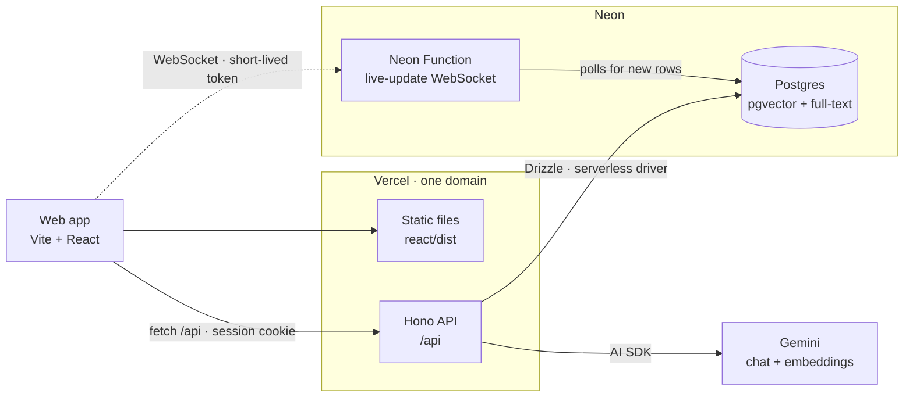
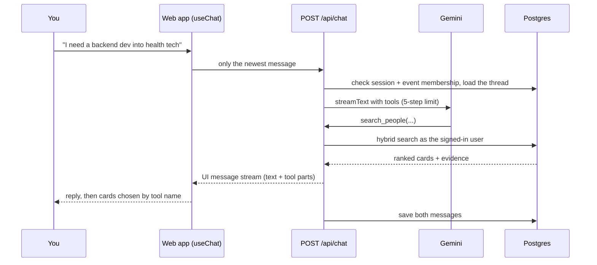

<div align="center">


# Hacky

**The AI chat that finds the exact person you need at a hackathon.**

A teammate, someone to network with, or a mentor. Hacky learns what you need,<br />
searches real profile data, and tells you *why* each match fits.

Built in 36 hours at [Knight Hacks IX](https://2026.knighthacks.org/) by a team of 3.


</div>

---

## The problem

Hackathons put hundreds of people in one building for a weekend, and most of them never find each other. Team building is a crowded room and a Discord channel that scrolls too fast. The backend dev who would complete your team is three tables away. The mentor who has shipped exactly what you're stuck on is answering someone else's question.

## What Hacky does

You tell Hacky what you need, the way you'd tell a friend. It does the looking.

| | |
|---|---|
| **Short intake, not a form** | Onboarding captures why you're here. After that, the agent only asks for what's still missing, with tappable answer chips. |
| **Matches with receipts** | Every person, team and mentor card carries the evidence it was ranked on. Match reasons are written only from fields the search returned. If nobody fits, Hacky says so and shows the closest people, labelled as closest. |
| **The agent drafts, you send** | Hacky writes the intro. You edit it and tap Send. No agent tool can send, accept, block or claim anything. |
| **Requests that turn into DMs** | One request per person per event. If two people request each other, both are accepted and one DM opens. |
| **Mentor help queue** | Describe what you're stuck on, Hacky drafts the help request, and mentors see a shared queue sorted by how well each one fits them. First claim wins and opens a chat. |
| **Knows the event** | Schedule, rooms, food, Wi-Fi, prizes and judging, answered from a per-event guide. Event cards are drawn from the app's own schedule, so times and rooms never come from the model. |
| **Live, on two devices** | Messages and requests arrive over a WebSocket, with polling as the fallback. |
| **Your own Hacky** | Everyone gets a knit Hacky avatar they can recolour and style, or they can use their profile photo. |

## How it works



The browser never talks to the database. The web app and the API share one domain, so the Better Auth session cookie just works: no CORS, no third-party cookies.

### One chat turn



The server owns the history and the identity. The client sends one message; the model can never choose whose data to read or write, because every tool is a closure over the session's user id. The full walkthrough is in [docs/chat.md](docs/chat.md).

### Matching

Search runs in three stages, in [server/matching/](server/matching/):

1. **Hard filters** remove people who shouldn't appear at all (blocked in either direction, not looking, wrong role).
2. **Hybrid search** runs Postgres full-text and pgvector cosine similarity over the same profile text, and fuses the two rankings with Reciprocal Rank Fusion in a single SQL query.
3. **Scoring** combines relevance with skill coverage and goal fit. Skills are normalized first (`nodejs` → `node.js`) and broader skills are implied one way (React counts as frontend; frontend doesn't count as React).

Results come back as strong matches, as closest fits with a note about what's missing, or as an honest no match. Mentors are scored separately, on skill overlap, relevance and whether they're available now.

The weights and thresholds are calibrated against written-down expectations in [seed/match-cases.json](seed/match-cases.json), and `npm run test:match` checks them against 180 seeded profiles.

### What the agent can do

| Tool | What it returns |
|---|---|
| `ask_with_options` | A question with answer chips, answered in the UI |
| `update_profile` | Saves what the person just told Hacky about themselves |
| `search_people` | Person, team or mentor cards with evidence, or no match |
| `get_profile` | One person's public profile |
| `draft_intro` | An editable intro for the user to send |
| `draft_help_request` | A mentor help request for the user to send |
| `my_status` | Requests, connections, team and help requests |
| `show_events` | Event cards from the app's own schedule |

Tool inputs and outputs are Zod schemas in [shared/contract.ts](shared/contract.ts), next to every API route and live-update message.

## Stack

| Layer | Choice |
|---|---|
| Web app | Vite + React 19, deployed as static files on Vercel |
| API | Hono, one Vercel function under `/api` |
| Database | Neon Postgres with pgvector and full-text search |
| Data access | Drizzle ORM over Neon's serverless driver (HTTPS and WebSocket, so it works on networks that block Postgres ports) |
| Auth | Better Auth, self-hosted, tables in Neon |
| AI | AI SDK 7 with Gemini for chat and 768-dimension embeddings |
| Live updates | A Neon Function serving WebSockets, with API polling as the fallback |
| Contracts | Zod, for tools, routes, live events and seed data |

## Run it locally

You need Node 22+ and access to the Neon project.

```sh
# 1. Environment: writes DATABASE_URL and the other Neon variables to .env.local
npx neon@latest env pull

# 2. API, at http://localhost:8787/api
npm install
npm run dev:api

# 3. Web app, in a second terminal
cd react
npm install
npm run dev
```

Open **http://127.0.0.1:5173** (not `localhost`: the session cookie is tied to `127.0.0.1`). Check the API at `/api/health`.

`.env.local` also needs `BETTER_AUTH_SECRET`, `BETTER_AUTH_URL`, `GOOGLE_GENERATIVE_AI_API_KEY`, `REALTIME_TOKEN_SECRET` and `DEMO_MODE=true`. It is git-ignored; never commit it.

With `DEMO_MODE=true`, the homepage opens a picker at `/api/demo/portal` that signs you in as any seeded person. One browser holds one signed-in person, so use two browser profiles to try a request, an accept and a DM between two people.

### Scripts

From the repo root:

| Command | What it does |
|---|---|
| `npm run dev:api` | Start the API with watch mode |
| `npm run typecheck` | Type-check the backend |
| `npm run test:match` | Check matching against `seed/match-cases.json` |
| `npm run test:prompts` | Check the prompt builder and event-guide loader |
| `npm run test:demo` | Check demo rules, with no live credentials needed |
| `npm run test:chat` · `test:history` · `test:social` | Chat route, history and conversation tests against the database |
| `npm run check:threads` | Validate every saved chat thread after a tool or card schema change |
| `npm run db:generate` · `db:migrate` | Generate and apply Drizzle migrations |
| `npm run seed:generate` · `seed:load` · `seed:reset` | Build, load and reset demo data |

In `react/`: `npm test` runs the frontend tests and `npm run build` makes the production build.

> Tests that run real matching or seed scripts use the hosted database. Don't run them casually.

## Repo map

```
react/                   the web app (Vite + React)
api/index.ts             Vercel entry; hands every /api request to the Hono app
server/
  app.ts                 session middleware, error mapping, route mounting
  routes/                one file per area: me, events, chat, requests, conversations, help, realtime, demo
  social/                requests, blocks, conversations and help: the rule-enforcing server functions
  matching/              hybrid search + scoring
  agent/                 model, prompts, tools, history and per-event guides
  db/                    Drizzle schema, client and transactions
  auth.ts                Better Auth config
shared/contract.ts       Zod schemas for every route, agent card and live-update message
functions/realtime.ts    Neon Function: the live-update WebSocket
drizzle/                 generated SQL migrations
seed/                    generator, 180 people, match cases, reset
docs/                    how the chat streams, and how the web app calls every route
```

## Built to be trusted

- **Every route that touches user data** requires a session and checks that the user belongs to the event.
- **Agent tools run as the signed-in user** and reuse the same server functions as the API.
- **Requests, conversations, help requests and blocks** change only inside one transaction that enforces the rules, with database constraints behind it.
- **Only public fields leave the server.** Embeddings and emails never reach the model or the browser.
- **Blocking is silent and total**: it applies everywhere, in both directions, and the other person isn't told.

## Further reading

- [AGENTS.md](AGENTS.md): the rules of the repo, folder ownership and product decisions
- [docs/chat.md](docs/chat.md): how the chat streams end to end
- [docs/frontend.md](docs/frontend.md): how the web app calls every route, in order
- [The plan](https://claude.ai/artifact/LTzFht4nHYw78N5U2h2G9t): the source of truth for scope and decisions

## What's next

Joining teams from a card, team chats outside the demo, Sign in with MLH, launch tickets signed by the hackathon's own portal, and an organizer dashboard. This weekend's build stops at finding the right person and starting the conversation.

---

<div align="center">

Made with too little sleep at Knight Hacks IX, UCF, October 2026.

</div>
